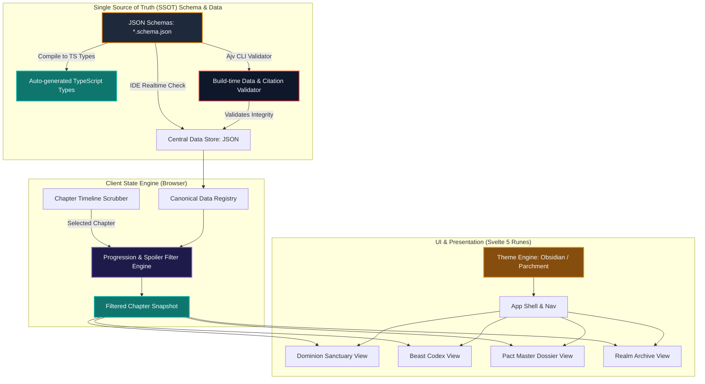

# Absolute Beast Dominion Companion & Codex — Architecture Specification

**Document Version:** 1.0.0  
**Target Platform:** Mobile-First Progressive Web App (PWA) + Desktop Browser  
**Core Principles:** 100% Client-Side Portability, Strict Data Integrity, Zero Spoilers via Chapter Synchronization, Dual Grimoire Theming.

---

## 1. System Overview & Core Architecture



### 1.1 Architectural Constraints & Boundaries
1. **Zero Server State & Zero User $\to$ Server Traffic:**
   - No backend runtime, user account tracking, or database servers.
   - The application is a static, offline-first bundle served from any static host (GitHub Pages, Vercel, Netlify, or local storage).
   - User settings (active chapter, selected theme, bookmarks) are persisted exclusively in `localStorage`.
2. **Canonical Exclusivity:**
   - Every piece of data (stats, skill mechanics, beast evolutions, bond thresholds, locations) must originate directly from the novel *Absolute Beast Dominion*.
   - Speculation or placeholder values are strictly forbidden.
3. **Chapter-Locked Progression (Anti-Spoiler Engine):**
   - All entries define the exact chapter in which they were first unlocked or modified.
   - When viewing Chapter $N$, any entity, skill, attribute change, or cognition breakthrough occurring at Chapter $> N$ is strictly filtered out or displayed with non-spoiler redacted indicators.

---

## 2. Strict Data Validation & Single Source of Truth (SSOT)

To avoid duplicate schema definitions and ensure maintainability, **JSON Schema (`.schema.json`) is the sole single source of truth**:

```
┌────────────────────────────────────────────────────────────────────────┐
│                   SINGLE-SCHEMA DATA PIPELINE                          │
├────────────────────────────────────────────────────────────────────────┤
│ 1. Define Once: Standard JSON Schema (`data/schemas/*.schema.json`)     │
├────────────────────────────────────────────────────────────────────────┤
│ 2. Real-Time IDE: `$schema` provides autocompletion & error highlights │
├────────────────────────────────────────────────────────────────────────┤
│ 3. Build & Pre-commit: Ajv runs validation against the schemas directly│
│    + Checks cross-file referential integrity (foreign key skill IDs)   │
│    + Enforces mandatory chapter/quote citations for all breakthroughs  │
├────────────────────────────────────────────────────────────────────────┤
│ 4. Type Generation: `json-schema-to-typescript` generates types        │
└────────────────────────────────────────────────────────────────────────┘
```

### 2.1 Schema Definition & Directory Structure

```
data/
├── schemas/                       # JSON Schema & Zod definition files
│   ├── beast.schema.json
│   ├── character.schema.json
│   ├── bond.schema.json
│   ├── skill.schema.json
│   ├── realm.schema.json
│   └── chapter.schema.json
├── beasts/                        # Modular beast entries
│   ├── shyra.json
│   ├── krik.json
│   ├── dryad.json
│   ├── agnivar.json
│   └── ashira.json
├── characters/
│   ├── leo.json
│   └── lily.json
├── mechanics/
│   ├── soul_ranks.json
│   ├── stat_formulas.json
│   └── xp_curves.json
├── world/
│   ├── academies.json
│   ├── bastions.json
│   └── danger_zones.json
└── chapters.json                  # Master chapter timeline & arc index
```

### 2.2 Canonical Enums & Controlled Vocabulary

All categorical progression fields are strictly governed by JSON Schema enums:

| Category | Schema Property | Type / Permitted Enum Values |
| :--- | :--- | :--- |
| **Star Rank** | `starRank` | `integer` (Range: `1` to `10`) |
| **Sub-Rank** | `subRank` | `"pseudo"` \| `"low"` \| `"middle"` \| `"high"` \| `"peak"` |
| **Bond Stage** | `bondStage` | `"chain"` \| `"blood"` \| `"soul"` |
| **Bloodline Tier** | `bloodlineTier` | `"ordinary"` \| `"mortal"` \| `"super"` \| `"noble"` \| `"royal"` \| `"divine"` |
| **Cognition Stage**| `cognitionStage`| `"feral"` \| `"juvenile"` \| `"adolescent"` \| `"mature"` \| `"transcendent"` |
| **Soul Rank** | `soulRank` | `"common"` \| `"uncommon"` \| `"rare"` \| `"super_rare"` \| `"epic"` \| `"legendary"` \| `"mythical"` \| `"divine"` |

### 2.3 Chapter-Tied Progression Schema Example

Each entry is strictly typed with numeric ranks, enum sub-ranks, and chapter numbers. For example, in `data/beasts/shyra.json`:

```json
{
  "$schema": "../schemas/beast.schema.json",
  "id": "shyra",
  "name": "Shyra",
  "species": "Shadow Obsidian Tiger / Obsidian Panther Line",
  "contractChapter": 1,
  "milestones": [
    {
      "minChapter": 1,
      "maxChapter": 40,
      "starRank": 1,
      "subRank": "low",
      "bloodlineTier": "noble",
      "bloodlinePurity": 12,
      "cognitionStage": "feral",
      "iq": 45,
      "bondStage": "chain",
      "bondPercentage": 35,
      "unlockedSkillIds": ["shadow_pounce", "feral_instinct"],
      "traits": []
    },
    {
      "species": "Obsidian Panther Cub",
      "minChapter": 71,
      "maxChapter": null,
      "starRank": 2,
      "subRank": "high",
      "bloodlineTier": "noble",
      "bloodlinePurity": 64,
      "cognitionStage": "adolescent",
      "iq": 115,
      "bondStage": "blood",
      "bondPercentage": 78,
      "unlockedSkillIds": ["shadow_pounce", "obsidian_armor", "abyssal_roar"],
      "traits": ["Obsidian Hide"]
    }
  ]
}
```

### 2.4 Automated Data Integrity Validator (`scripts/validate-data.ts`)

The validation pipeline enforces:
1. **Enum Strictness:** `starRank` (integer 1-10), `subRank` (`pseudo`, `low`, `middle`, `high`, `peak`), `bondStage` (`chain`, `blood`, `soul`), `bloodlineTier`, `cognitionStage`, and `soulRank` must strictly match their enum schemas.
2. **Referential Integrity:** Every `unlockedSkillIds` entry must exist in `data/mechanics/skills.json`.
3. **Timeline Sanity:** `minChapter` must be $\le$ `maxChapter`, and referenced chapters must exist in `data/chapters.json`.
4. **Chapter Attribution:** Every stat milestone, evolution, and trait unlock must specify the exact chapter number where it occurred.

---

## 3. Technology Stack: Svelte 5 + TypeScript + Vite

The application is built on **Svelte 5 + TypeScript + Vite** for maximum runtime efficiency, zero Virtual DOM overhead, and a clean, compiler-driven component model.

```
┌────────────────────────────────────────────────────────────────────────┐
│                          PROJECT TECH STACK                            │
├───────────────────┬────────────────────────────────────────────────────┤
│ Framework         │ **Svelte 5** (Runes reactivity: `$state`, `$derived`)│
│ Build Tool        │ **Vite** (Instant HMR, tree-shaking, static build) │
│ Language          │ **TypeScript** (Strict type checking)              │
│ Data Validation   │ **JSON Schema + Ajv** (Single source of truth)     │
│ Styling / Theming │ **CSS Custom Properties + Scoped Component Styles**│
│ PWA & Offline     │ **vite-plugin-pwa** (Workbox cache-first strategy) │
│ Icons & Fonts     │ **Lucide Svelte** + **Cinzel & Space Grotesk**     │
└───────────────────┴────────────────────────────────────────────────────┘
```

### 3.1 Svelte 5 Component Architecture & File Layout
- **Single File Components (`.svelte`)**: Natural encapsulation of `<script lang="ts">`, HTML markup, and scoped `<style>`.
- **Runes Reactivity**:
  - `$state`: For active chapter, current tab, and theme state.
  - `$derived`: For computing filtered beasts, character stats, and bond milestones in real-time as the chapter timeline scrubs.
- **Component Hierarchy**:
  - `src/components/layout/AppShell.svelte`: Persistent frame containing the chapter scrubber HUD, theme switcher, and navigation bar.
  - `src/components/layout/ChapterHUD.svelte`: Chapter scrubber with preset story arc shortcuts.
  - `src/components/sanctuary/DominionSanctuary.svelte`: Active party roster, bond percentages, and transferred traits.
  - `src/components/codex/BeastCodex.svelte`: Bestiary, star ranks, lineage purity, and cognition IQ tracker.
  - `src/components/dossier/PactMasterDossier.svelte`: Leo's dual-soul attributes, soft caps, and feedback log.
  - `src/components/realm/RealmArchive.svelte`: Academy bastions, danger zones, and world lore.
  - `src/components/common/ChapterBadge.svelte`: Chapter origin indicator tag (e.g., "Unlocked Ch. 76").

---

## 4. Dual-Theme Design System & CSS Token Architecture

```
┌────────────────────────────────────────────────────────────────────────┐
│                        DUAL THEME DESIGN MATRIX                        │
├──────────────────────────┬─────────────────────────────────────────────┤
│ Dark Codex (Default)     │ Light Illuminated Grimoire                  │
├──────────────────────────┼─────────────────────────────────────────────┤
│ Void Obsidian `#0a0e1b`  │ Radiant Sunlit Ivory Parchment `#fbf8f0`    │
│ Deep Surface `#0f1320`   │ Warm Layered Vellum `#f4eee2` / `#ebe3d1`   │
│ Imperial Gold `#d97706`  │ Burnished Bronze & Amber `#8c6020`          │
│ Silver Ink `#f1f5f9`     │ Archival Sepia Ink `#1e2433`                │
│ Astral Cyan Mana `#00a6e0│ Skyward Lapis `#0284c7`                     │
│ Primordial Violet        │ Royal Amethyst                              │
└──────────────────────────┴─────────────────────────────────────────────┘
```

### 4.1 Token Structure (`src/styles/themes.css`)

```css
:root, [data-theme="dark"] {
  --font-display: 'Cinzel', serif;
  --font-body: 'Space Grotesk', sans-serif;

  --color-bg-base: #0a0e1b;
  --color-bg-surface: #0f1320;
  --color-bg-card: #171b28;
  --color-bg-card-hover: #232737;

  --color-border-filigree: #d97706;
  --color-border-subtle: #262937;

  --color-text-title: #ffdcc3;
  --color-text-body: #dfe1f5;
  --color-text-muted: #a38c7c;

  --color-accent-mana: #00a6e0;
  --color-accent-soul: #b76dff;
  --color-accent-gold: #ffb77d;
}

[data-theme="light"] {
  --color-bg-base: #fbf8f0;
  --color-bg-surface: #f4eee2;
  --color-bg-card: #ebe3d1;
  --color-bg-card-hover: #e0d5be;

  --color-border-filigree: #8c6020;
  --color-border-subtle: #d6c8b0;

  --color-text-title: #432100;
  --color-text-body: #1e2433;
  --color-text-muted: #78716c;

  --color-accent-mana: #0284c7;
  --color-accent-soul: #7e22ce;
  --color-accent-gold: #b45309;
}
```

---

## 5. Screen & View Hierarchy

```
                    ┌────────────────────────────┐
                    │      APP SHELL & HUD       │
                    │  [Chapter Sync Timeline]   │
                    │  [Dual Theme Switcher]     │
                    └─────────────┬──────────────┘
                                  │
         ┌────────────────┬───────┴────────┬────────────────┐
         ▼                ▼                ▼                ▼
┌─────────────────┐ ┌───────────┐ ┌─────────────────┐ ┌───────────┐
│ DOMINION        │ │ BEAST     │ │ PACT MASTER     │ │ REALM     │
│ SANCTUARY       │ │ CODEX     │ │ DOSSIER         │ │ ARCHIVE   │
├─────────────────┼───────────┼─────────────────┼───────────┤
│ • Active Party  │ • Bestiary  │ • Dual-Soul Stats │ • Map/Arcs│
│ • Bond Rings    │ • Cognition │ • Soft-Cap Limits │ • Bastions│
│ • Transferred   │ • Lineage   │ • Feedback Stat   │ • Guilds  │
│   Traits        │ • Star Ranks│   Log             │ • Lore    │
└─────────────────┘ └───────────┘ └─────────────────┘ └───────────┘
```

---

## 6. Progressive Web App (PWA) & Asset Pipeline

1. **Brand Assets Integration:**
   - [app logo.png](file:///c:/Users/benjv/Dev/ABD/img/app%20logo.png) $\to$ Automated export to standard icon sizes (`192x192`, `512x512`, `maskable`, `apple-touch-icon`).
   - [full-logo.png](file:///c:/Users/benjv/Dev/ABD/img/full-logo.png) $\to$ Grimoire splash screen and header crest.
2. **Offline Caching Strategy:**
   - **Precached Assets:** All HTML, CSS, JavaScript, Web Fonts (Cinzel, Space Grotesk), and Static JSON data files.
   - **Cache-First Runtime:** Instant zero-latency loading even when completely offline or in airplane mode.
